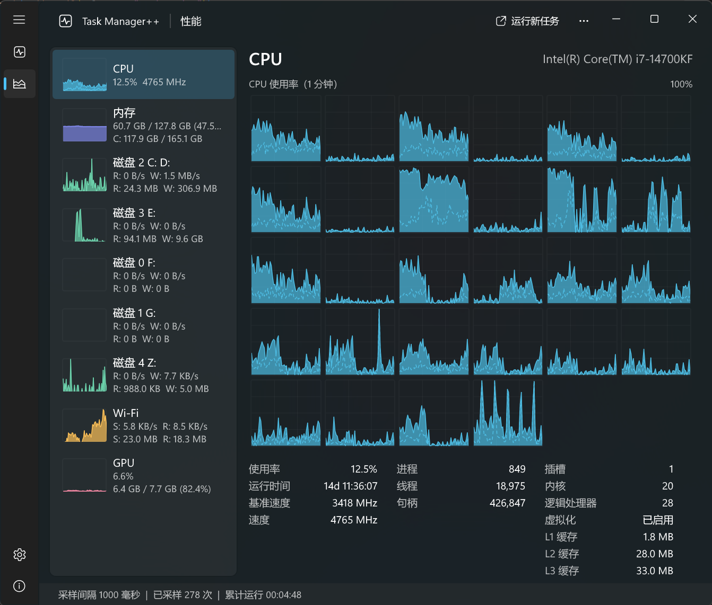
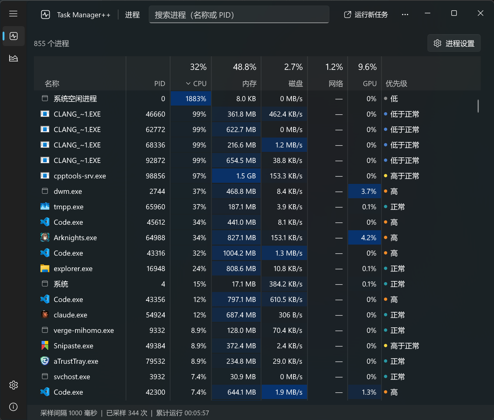
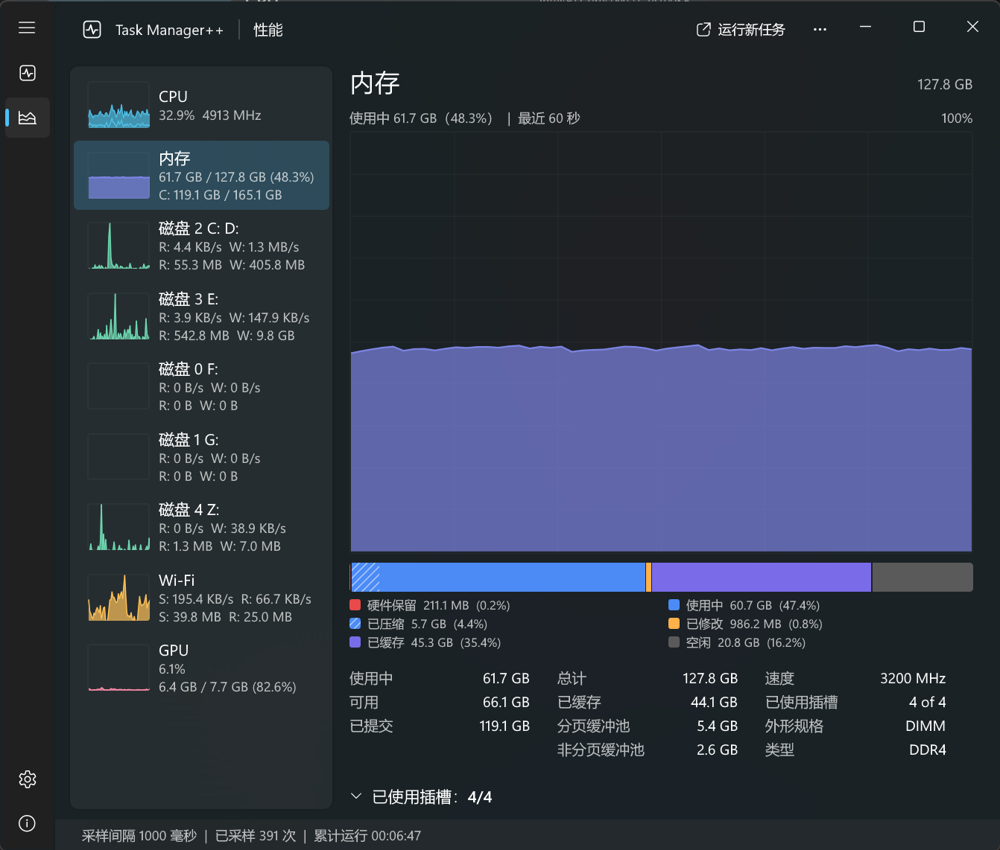

# TaskManagerPlusPlus

[English](README.md) | [简体中文](README.zh-CN.md)

A modern replacement for the Windows Task Manager, built with **C++20** and **WinUI 3**.

TaskManagerPlusPlus aims to be lightweight, fast, and visually faithful to the
Windows 11 Task Manager, while improving on it where it matters most: chart
colour customisation, metric collection performance, and code maintainability.

> **Project status: milestone M1 complete, M2 starting.**
> The application provides process and performance pages, with process controls in a collapsible sidebar. CPU and memory
> are read natively; disk, network and GPU come from the Windows performance
> counters and DXGI; memory modules come from the firmware's SMBIOS table. Every
> metric on the performance page is plotted with configurable colours and stroke
> widths, each disk and adapter has its own chart, and double-clicking the sidebar
> collapses the window to the list alone. Automated tests cover the metrics, settings and native theme transitions, and all three
> configurations build; the release is packaged as a self-contained folder that
> needs nothing installed on the target machine.

## Screenshots

### CPU performance



### Processes



### Memory



## Highlights

- **Faithful to Windows 11** — layout, spacing, colour, icons and interaction
  mirror the built-in Task Manager, so there is nothing new to learn.
- **Native metric collection** — every counter comes from native Windows APIs on
  a high-performance path, with no WMI on the hot path. Per-process network
  traffic uses ETW and requires elevation on Windows.
- **Non-blocking UI** — sampling runs on background threads and publishes
  immutable versioned snapshots, so the UI never waits on a probe.
- **Customisable charts** — per-metric colours chosen with the system colour
  picker in a flyout, independent CPU kernel colours and widths, configurable
  fill opacity, and light, dark or system theme with optional native Mica.
- **Per-device charts** — every disk and network adapter gets its own row and its
  own history, with reads or received traffic solid and writes or sent traffic
  dashed on one shared axis.
- **Hardware inventory** — memory slots, module type, speed, bus width and part
  numbers, read from the firmware table that no Windows counter exposes.
- **Compact mode** — double-click the sidebar to collapse the window to the list.
- **Remembers where you were** — window position and size, both sidebar widths,
  the navigation rail's state, and which page to open on.
- **Process table controls** — select visible columns, drag headers to reorder,
  and recognise priority levels by coloured dots. Column layout is remembered.
- **Sampling controls** — set a 500–5000 ms interval and retain 60–1800 seconds
  of chart history. Changes apply immediately while retaining collected history.
- **Languages and About** — switch between English and Simplified Chinese in
  Settings; translations live in JSON resources. About sits below Settings and
  links to the version, source and license. The status bar shows session uptime.

Planned but not yet implemented: NVML temperature and power figures for NVIDIA
adapters. See [docs/ROADMAP.md](docs/ROADMAP.md).

CPU core sensors, NVIDIA telemetry and optional hardware driver integration are
covered in [the hardware monitoring research](docs/HARDWARE_MONITORING.md), including local capability probes.

## Requirements

| Component | Version |
| --- | --- |
| Operating system | Windows 11 or later |
| Architecture | x64 |
| Visual Studio | 2026 (MSVC v145) or 2022 (v143) |
| Windows SDK | 10.0.26100.0 |
| Windows App SDK | 1.8 |
| vcpkg | For third-party dependencies |

## Building

```powershell
# Debug, then run the tests
tools\build.bat Debug test

# Release
tools\build.bat Release
```

`tools\build.bat` locates Visual Studio and vcpkg itself, installs the vcpkg
dependencies on a first build, restores the NuGet packages and builds the solution.
Output lands in `build\x64\<Configuration>\`.

Visual Studio is found through `vswhere`, with a short list of conventional paths as
a fallback. If neither finds it, set `VSBASE` to the installation directory. vcpkg is
taken from `VCPKG_ROOT` when that is set, which is also what `build.bat <cfg> deps`
uses to install the dependencies by hand.

See [docs/BUILD.md](docs/BUILD.md) for environment setup and troubleshooting.

## Releasing

```powershell
# Build Release and assemble dist\TaskManagerPlusPlus-<YYMMDDNN>-win-x64 plus its zip
tools\package.ps1 -Version 26111901 -Build

# Build the MSI installer from that folder
tools\build-msi.ps1 -Version 26111901
```

The version is the date as YYMMDD followed by a two-digit sequence for that day:
`26111901` is the first release on 19 Nov 2026. Omit `-Version` to use today's date
with sequence 01, or pass `-Sequence N` for another release on the same day. The
same string is written into the executable's version resource and the package name.
Windows Installer requires a numeric `major.minor.build`, so the MSI stores it as
`YY.MM.DDNN` (`26.11.1901`); the installed product is still named after the full
version.

The build output directory is not a release: it also holds the static libraries, the
test binary and gmock. The packaging script copies only what runs, puts the Visual C++
runtime next to the executable so that nothing has to be installed, keeps only the
Chinese and English Windows App SDK locale folders, verifies that the result is
complete, and zips it.

`tools\build-msi.ps1` builds the installer with WiX 3.14, downloaded once into
`.cache\wix314`. The MSI installs per machine under Program Files, shows the standard
install-location dialog, adds a start-menu shortcut, upgrades previous versions in
place and can be removed from Apps & Features.

Two configurations matter here. `Release` is built without any debug information —
no PDB, no debug directory — and `RelWithDebInfo` is the one that keeps symbols, for
profiling and crash dumps.

A WinUI 3 native application cannot be collapsed into a single executable: there is no
static `Microsoft.UI.Xaml*.lib`, and Microsoft's `PublishSingleFile` is a .NET model.
The deliverables are therefore a portable folder, a zip and an MSI. See
[docs/BUILD.md](docs/BUILD.md) for what the package contains and how it is checked.

The Windows App SDK metapackage is deliberately not referenced. It also pulls the AI,
ML and Widgets component packages, which this application never uses; referencing
Base/Foundation/InteractiveExperiences/WinUI/DWrite directly keeps onnxruntime,
DirectML and the Workloads payload out of the package. See
`Directory.Packages.props`.

### Continuous integration

`.github/workflows/build.yml` builds every push on `windows-latest`: it derives the
version from the date and the number of builds already run that day, builds and
packages, creates the MSI, runs the unit tests, smoke-tests the MSI payload and
uploads both artefacts.

## Running

```powershell
cd build\x64\Debug
.\tmpp.exe
```

Or run the packaged build, which is the same executable with its runtime beside it:

```powershell
dist\TaskManagerPlusPlus-<version>-win-x64\tmpp.exe
```

> The application must run in an **interactive desktop session**. WinUI 3 cannot
> initialise on a service window station (for example, Session 0), where it
> fail-fasts inside the runtime before any application code executes.
>
> This also means its single-instance check cannot be exercised from a service
> session: `Local\` named mutexes and `FindWindow` are both scoped to a session by
> design, so two launches from Session 0 will not see each other.

## Documentation

| Document | Scope |
| --- | --- |
| [docs/ARCHITECTURE.md](docs/ARCHITECTURE.md) | Layer model, dependency rules, sampling pipeline |
| [docs/BUILD.md](docs/BUILD.md) | Environment setup, build commands, troubleshooting |
| [docs/METRICS.md](docs/METRICS.md) | Metric-to-native-API mapping and performance constraints |
| [docs/CODE_CONVENTIONS.md](docs/CODE_CONVENTIONS.md) | Naming, formatting, logging, error handling |
| [docs/ROADMAP.md](docs/ROADMAP.md) | Milestones and deferred features |

## License

[MIT](LICENSE)
